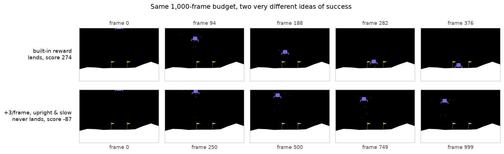
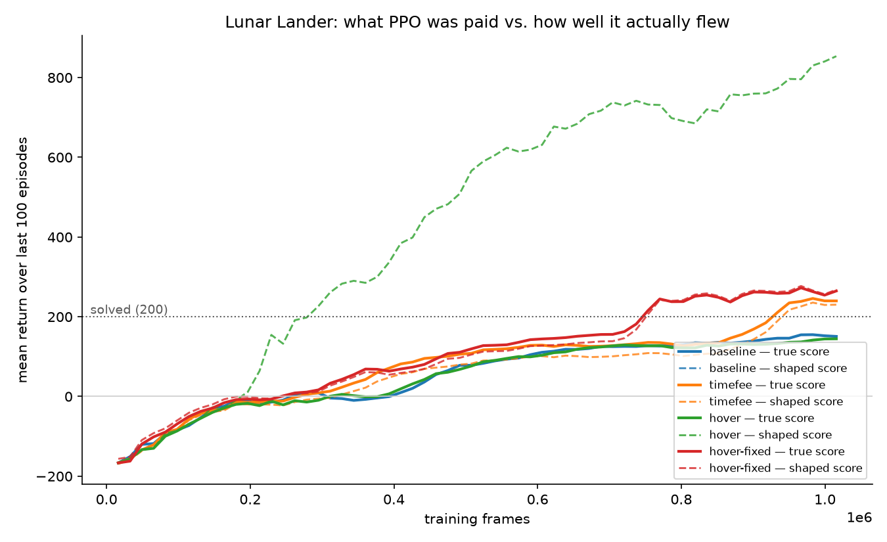

# Proximal Policy Optimization: Reward Shaping Ablation

**Paid to hover: an agent that learned to hover forever, because that is
exactly what I paid it for.**

I trained PPO (Proximal Policy Optimization) to land the Gymnasium lunar lander, then wrote a reward rule that
sounds obviously correct, retrained, and watched the agent stop landing
altogether. It scores **−102** while being **paid +684**. Then I fixed it.



*Top: the built-in reward. Bottom: `+3 a frame for being upright and slow`. Same
game, same physics, same 1,000-frame budget.*

**[▶ Live demo](https://subtle-zuccutto-36f4fe.netlify.app/)** · Runs in the
browser — scroll to scrub the real flight, or fly it yourself.

---

## The result

Evaluated on the **raw** environment with the reward wrapper off, 20 episodes,
deterministic actions. Lunar Lander counts 200+ as solved.

| Reward the agent was trained on | True score | Paid | Outcomes |
|---|---:|---:|---|
| Built-in reward | **259.3** ± 20.0 | 259.3 | 20/20 landed |
| Built-in − 0.03 a frame | **244.3** ± 58.2 | 234.7 | 19 landed, 1 crashed |
| **+3 a frame, upright & slow** | **−102.0** ± 23.2 | **+684.3** | **0 landed, 20/20 timed out** |
| The same idea, paid correctly | **272.5** ± 20.1 | 276.7 | 20/20 landed |

The third row is the point. It is not broken, not undertrained, and not
unlucky. It is optimal play for the reward it was given, and at the 1,000-frame
cutoff it sits at **height 0.94 with 0/2 legs down and speed 0.05** — airborne,
level, going nowhere, in every single episode.



---

## Why hovering wins

The episode is cut off at 1,000 frames. A bonus of +3 a frame is worth up to
**3,000**, while the main engine costs **0.30** a frame. Landing *ends* the
episode, and ending the episode stops the payments.

So the agent's best move is to never finish. Nothing went wrong — the reward
said hovering was worth ten times a good landing, and PPO believed it.

### The fix

The built-in reward never had this problem, and the reason is structural. It
computes a "how good is this" number each frame and pays the **change** in it,
not the level:

```
score  = −100·distance − 100·speed − 100·|tilt| + 10·legs_down
reward = score − previous_score − fuel        (0.30 main, 0.03 side)
final  = +100 at rest, or −100 for a crash
```

Sitting still earns nothing, however nice the spot. So the fix is to pay the
bonus the same way — as [potential-based shaping](https://people.eecs.berkeley.edu/~pabbeel/cs287-fa09/readings/NgHaradaRussell-shaping-ICML1999.pdf):

```
φ(s)   = −k·(|tilt| + speed)
extra  = γ·φ(s′) − φ(s) − 0.03
```

φ is forced to 0 at terminal states, which is what makes Ng, Harada & Russell's
guarantee hold: shaping of this form provably cannot change which policy is
optimal, only how fast it is found. A closed loop nets to zero, so there is
nothing to farm by waiting.

**It is the form that fixes it, not a smaller number.** Pushed to `k=60` — an
aggressive shaping term — it still scores 272.5 and lands 20/20.

---

## Breaking it took more than the obvious bonus

My first attempt at the hack **did not work**, and that turned out to be the
most interesting part.

`+1` a frame for `|tilt| < 0.1` and `speed < 0.1` scored 245.6 and landed
20/20. The incentive was already there — 1,000 × (1.0 − 0.30 fuel) = **+700**
against roughly +250 for landing — but PPO never escaped the landing optimum.

The training log looked alarming anyway: shaped return ~850 against a true ~150.
That gap was mostly an artifact. Under stochastic rollouts the action noise
keeps the lander awake so episodes never terminate, and the **baseline** policy
timed out 17/20 the same way. A gap in the log is a hint, not a verdict.

Making it bite needed a steeper bonus and a tolerance loose enough to stumble
into:

| Bonus | Tolerance | True score | Outcomes |
|---|---|---:|---|
| +1 | tilt 0.1, speed 0.1 | 245.6 | 20/20 landed |
| +3 | tilt 0.1, speed 0.1 | 184.8 | 16 landed, 2 crashed, 2 timed out |
| +1 | tilt 0.2, speed 0.3 | 114.6 | 15 landed, 5 never settled |
| **+3** | **tilt 0.2, speed 0.3** | **−102.0** | **0 landed, 20/20 timed out** |

There are two distinct ways to never finish, and `evaluate.py` tells them apart.
At the loose tolerance with +1 the agent *landed* but kept firing so the lander
never fell asleep and the episode never ended. At +3 it stopped pretending and
just hovered.

### One run proves nothing

Training is stochastic, so nothing here rests on a single seed:

| Run | Seed 0 | Seed 1 | Seed 2 |
|---|---:|---:|---:|
| Hacked reward, true score | −102.0 | −84.6 | −99.5 |
| Height at the cutoff | 0.94 | 0.86 | 1.02 |
| Baseline control | 259.3 | 258.5 | — |

Sixty episodes across three seeds, not one landing between them, hovering within
a few centimetres of the same altitude each time.

---

## The web UI

A scroll-driven walkthrough: scrolling **scrubs the actual flight** frame by
frame, through the descent and then through the hacked run, where the two score
counters pull apart in front of you.

Nothing in it is faked. `export_trajectories.py` dumps real Box2D output — body
transform, both leg polygons, the eight observations and both reward streams per
frame — so the browser only draws what actually happened.

The craft is a shaded 3D lunar module ([`ui/craft3d.js`](ui/craft3d.js)): a
painter's-algorithm renderer with **no dependency**, with quilted MLI
insulation, panel plates, propellant tanks, RCS clusters, handrails and a
ladder. It is built at three levels of detail and cached, with only the legs
rebuilt per frame, so a craft 30 pixels across costs the silhouette and one
filling the screen costs everything. Measured at **75 fps**, worst frame 14.4 ms.

The physics underneath is unchanged 2D Box2D — the model's roll and both leg
hinge angles are read off the real bodies.

### Fly it yourself

Arrow keys fire the engines, **one per frame**, which is the same single choice
the agent gets. You pick which reward pays you, so you can try to farm the
broken one by hovering and watch your own paid score pull away from your true one.

This runs the real environment, not an approximation:
[`ui/sim.js`](ui/sim.js) re-runs Box2D through
[planck.js](https://piqnt.com/planck.js/) with the same shapes, densities,
joints, engine impulses, solver iteration counts and reward function as
`lunar_lander.py`. Checked against Python:

| Check | Python | Browser |
|---|---:|---:|
| Lander mass / inertia | 4.81667 / 0.83331 | 4.81667 / 0.83331 |
| Coast all the way down (20 eps) | −143.5, 71.2 frames | −139.6, 72.5 frames |
| Left engine held (12 eps) | −596.8, 68.7 frames | −604.7, 69.3 frames |
| Main engine held (40 eps) | −876.8 ± 647 | −813.5 ± 537 |
| Δvx per frame, side engines | ∓0.0507 / ±0.0479 | ∓0.0497 / ±0.0512 |

Every case crashed in both. The held-main-engine number has a standard deviation
of ~600, so the gap between the means is well inside noise — at n=12 it had
looked like a real discrepancy, which is its own small lesson about reading one
number.

---

## What's in here

| File | What it does |
|---|---|
| [`rewards.py`](rewards.py) | The reward wrappers — the actual experiment |
| [`train.py`](train.py) | PPO training with any reward wrapper |
| [`evaluate.py`](evaluate.py) | Scores a policy on the **raw** env, and names the failure mode |
| [`random_agent.py`](random_agent.py) | Untrained flailing, plus the 8 numbers the agent sees |
| [`record.py`](record.py) | mp4 + gif of a policy flying |
| [`plot_curves.py`](plot_curves.py) | Learning curves: paid score vs true score |
| [`contact_sheet.py`](contact_sheet.py) | Side-by-side strip of two policies flying |
| [`run_experiments.sh`](run_experiments.sh) | The whole sweep, end to end |
| [`hack_search.sh`](hack_search.sh) | Finds the bonus setting where the hack wins |
| [`confirm.sh`](confirm.sh) | Extra seeds, so nothing rests on one run |
| [`export_trajectories.py`](export_trajectories.py) | Dumps real episodes to JSON for the UI |
| [`ui/index.html`](ui/index.html) | The page: scroll scenes, console, hand-flying |
| [`ui/craft3d.js`](ui/craft3d.js) | Shaded 3D lunar module with LOD |
| [`ui/sim.js`](ui/sim.js) | LunarLander-v3 ported to the browser |
| [`build_site.py`](build_site.py) | Builds `docs/`, the deployable static site |

---

## Running it

```bash
uv venv --python 3.12 .venv          # or: python3 -m venv .venv
VIRTUAL_ENV=.venv uv pip install -r requirements.txt

.venv/bin/python random_agent.py     # watch it fail
./run_experiments.sh                 # train all four, score, record
./run_experiments.sh seeds           # extra seeds
```

Each 1,000,000-frame run takes about 10 minutes on an 8-core laptop CPU. No GPU.

Hyperparameters are the [RL Baselines3 Zoo](https://github.com/DLR-RM/rl-baselines3-zoo)
settings tuned for this environment (`n_envs=16`, `n_steps=1024`,
`batch_size=64`, `n_epochs=4`, `gamma=0.999`, `gae_lambda=0.98`,
`ent_coef=0.01`).

### Measuring honestly, by construction

SB3's `make_vec_env` wraps `Monitor` **inside** a custom wrapper, which turns
out to be exactly what this needs: `rollout/ep_rew_mean` is always the game's
own reward, comparable across every run, while `rollout/shaped_ep_rew_mean` is
what PPO is actually being paid. Those two lines pulling apart *is* reward
hacking, visible live in the training log. `evaluate.py` runs the raw env by
default for the same reason — a bonus of mine must never be able to flatter the
number.

### Hosting it

```bash
python build_site.py --zip
```

Writes `docs/` (776 KB, no build step) and a zip with `index.html` at the root.
Drag the zip onto [Netlify Drop](https://app.netlify.com/drop), or push and use
GitHub Pages (Settings → Pages → `main` / `docs`), Vercel or Cloudflare Pages
with `docs` as the publish directory.

---

## Things that bit me

- **`LunarLander-v2` doesn't exist any more.** Current Gymnasium is `v3`. Most
  tutorials are a version behind.
- **Python too new.** PyTorch had no wheels for the 3.14 on this machine;
  pinning the venv to 3.12 fixed it. (The `swig` dance older guides describe is
  no longer needed — `box2d==2.3.10` ships arm64 wheels.)
- **Box2D reorders polygon vertices** when it builds the convex hull, so you
  cannot assume `shape.vertices[i]` matches the vertex you passed in. Inferring
  the craft's orientation from them had the engine firing upward. Export the
  body transform instead.
- **A page with no doctype is in quirks mode**, which puts scrolling on `<body>`
  instead of `<html>` and mojibakes every em dash. The Artifact host supplies a
  skeleton; anywhere else you supply it yourself.
- **Watch the clip, not the score.** The whole point of the hacked run: its
  paid score climbs beautifully. You have to look at the rocket — or at the
  outcome breakdown, where it never lands.
